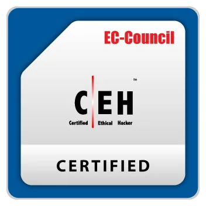

## Hello 👋

My name is **Andreas** and I'm a [Hacker](). I love to learn new things and use my skills to test IT systems for security flaws and bugs. I live in Hamburg, Germany and work at Hamburg Wasser as a cyber security engineer.

### My Expertise
- Penetration Testing
- Bug Bounty Hunting
- Web Application Security
- Mobile Application Security (Android)
- AWS Cloud Security
- IT Security Trainings
- Threat Modelling

### Get in Contact
📫 You can contact me via
- Mastodon: <https://infosec.exchange/@AndreasWienes>
- Mail: mail \[at\] wienes \[dot\] com
- LinkedIn: <https://www.linkedin.com/in/andreas-wienes-cyber-security/>

## Professional Achievements

{: .left width="200" height="200"}

[Certified Ethical Hacker (CEH) – Nachweis bei Credly](https://www.credly.com/badges/1da86fa7-a361-43c0-bf12-b8728050c664)

[Pentester Academy Certified Cloud Security Professional (PACSP)](https://bootcamps.pentesteracademy.com/course/cloud-security-aws-on-demand)

#### Hack The Box
[Profil bei Hack The Box](https://app.hackthebox.com/profile/205798)

#### TryHackMe
[Profil bei TryHackMe](https://tryhackme.com/)
